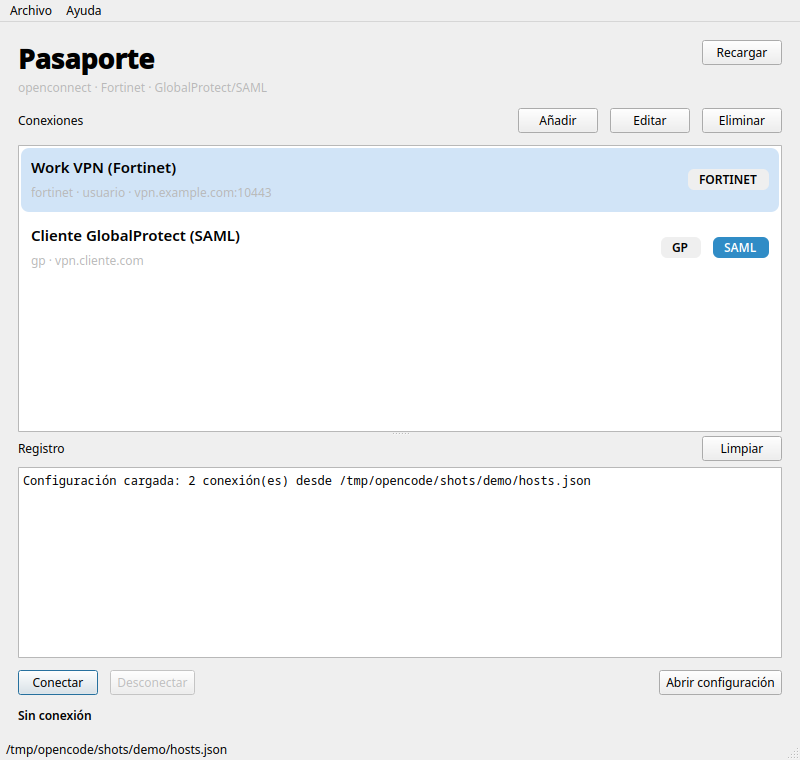
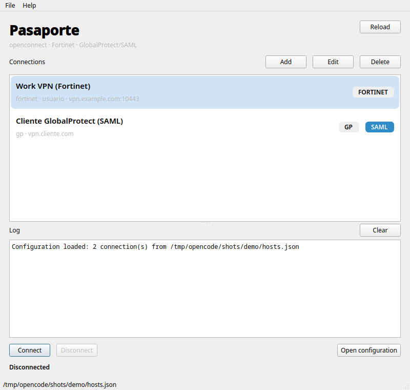

# Pasaporte

[English](./README.md) · **Español**

[](https://github.com/jsnoriegam/Pasaporte/actions/workflows/appimage.yml)
[](https://github.com/jsnoriegam/Pasaporte/releases)
[](./LICENSE)

[](https://buymeacoffee.com/jsnoriegam)

Interfaz gráfica en **Python + PySide6/Qt** para `openconnect`, con soporte
de **GlobalProtect con SAML** dentro de la propia aplicación (WebView
embebido).

La misma lista JSON de conexiones sirve para Fortinet, GlobalProtect y el
resto de protocolos de openconnect.



## Requisitos

- Linux con escritorio (X11 o Wayland).
- Python 3.10 o superior.
- `openconnect` instalado y en el `PATH` (o define `OPENCONNECT_BIN` con su ruta).
- `pkexec` (recomendado) o `sudo`.
- PySide6 con los módulos `QtWebEngineWidgets` y `QtWebSockets`.
  El paquete `PySide6` de PyPI los incluye.

Comprobaciones rápidas:

```bash
openconnect --version
which pkexec
.venv/bin/python -c "import PySide6; from PySide6 import QtWebEngineWidgets, QtWebSockets; print(PySide6.__version__)"
```

## Instalación

Todo se instala dentro del proyecto, en `.venv/`; no hace falta tocar los
paquetes globales del sistema:

```bash
cd /ruta/a/pasaporte

python3 -m venv .venv
.venv/bin/pip install -r requirements.txt
```

Si ya existe `.venv`, basta con instalar/actualizar las dependencias:

```bash
.venv/bin/pip install -r requirements.txt
```

## Ejecución

```bash
# configuración por defecto: ~/.config/pasaporte/hosts.json
./pasaporte

# o indicando otro archivo
./pasaporte --config ~/.config/vpn/hosts.json

# con el venv activado
PYTHONPATH=src python3 -m pasaporte --config ./vpn.json

# conectar automáticamente al arrancar (por nombre de conexión)
./pasaporte --config vpn.json --connect UTB

# mostrar la versión
./pasaporte --version
```

`./pasaporte` detecta y usa automáticamente el `.venv` del proyecto si existe,
aunque no lo tengas activado. Así no depende de los paquetes globales del
sistema.

En el primer arranque, si no existe `~/.config/pasaporte/hosts.json` y hay una
configuración en `~/.config/vpn/hosts.json` o en `vpn.json`, Pasaporte te
ofrecerá **Importar** o **Usar solo esta sesión**. En modo solo-lectura puedes
migrar más tarde con el botón **Migrar configuración**.

También se puede usar la variable `VPN_CONFIG`:

```bash
VPN_CONFIG=./vpn.json ./pasaporte
```

> Importante: usa `./pasaporte` o `PYTHONPATH=src python3 -m pasaporte`. Si
> importas y creas la `QApplication` por tu cuenta, hay que configurar el
> puerto de DevTools antes de inicializar QtWebEngine. El lanzador ya lo hace.

### Bandeja del sistema

Si hay bandeja del sistema, cerrar o minimizar la ventana deja Pasaporte en la
bandeja, así que la VPN sigue conectada. Para desactivarlo usa
**Archivo → Minimizar a la bandeja**. Para salir usa **Archivo → Salir**
(`Ctrl+Q`) o el menú de la bandeja.

GNOME no muestra iconos de bandeja por defecto. Instala la extensión
*AppIndicator and KStatusNotifierItem Support* para tenerla; sin bandeja, la
opción aparece desactivada y cerrar la ventana cierra la aplicación.

El icono de la bandeja muestra el estado de la conexión, y su tooltip el
texto de estado. Aparecen notificaciones cuando se establece una conexión con
la ventana oculta, cuando una conexión se cae y cuando hay un error.

### Reconexión e inicio con la sesión

- **Archivo → Reconectar automáticamente** (desactivado por defecto). Si el
  túnel se cae sin que hayas desconectado, Pasaporte reintenta a los 5, 15 y
  30 segundos. Mientras está activo, la contraseña que escribiste se guarda
  **solo en memoria** hasta que desconectes o se agoten los reintentos; nunca
  se escribe en disco. Las sesiones SAML no se pueden renovar en segundo
  plano: tras una caída hay que volver a conectar e iniciar sesión.
- **Archivo → Iniciar con la sesión** crea
  `~/.config/autostart/io.github.jsnoriegam.pasaporte.desktop`. Pasaporte
  arranca entonces oculto en la bandeja (`--start-hidden`). Con el AppImage, la
  entrada apunta a la ruta actual del AppImage: si mueves el archivo, desactiva
  la opción y vuelve a activarla.

### Acceso desde el menú de aplicaciones

El proyecto incluye `pasaporte.desktop`. Para instalarlo:

```bash
mkdir -p ~/.local/share/applications
cp pasaporte.desktop ~/.local/share/applications/
update-desktop-database ~/.local/share/applications 2>/dev/null || true
```

Ajusta la línea `Exec=` si mueves el proyecto de sitio.

## AppImage

El AppImage incluye Python, PySide6 y QtWebEngine. **No incluye openconnect**:
usa el del sistema o el que indiques con `OPENCONNECT_BIN`.

### Construir

Con Podman (recomendado):

```bash
./packaging/build-in-podman.sh
```

Con Docker:

```bash
CONTAINER_ENGINE=docker ./packaging/build-in-podman.sh
```

El resultado queda en:

```
dist/Pasaporte-0.1.0-beta.1-x86_64.AppImage
```

La build usa Ubuntu 22.04 dentro del contenedor para mantener compatibilidad
con glibc. La primera vez descarga PySide6 dentro del contenedor.

### Ejecutar

```bash
chmod +x dist/Pasaporte-*.AppImage
./dist/Pasaporte-*.AppImage
```

Requiere en el host:

- `openconnect` (o `OPENCONNECT_BIN=/ruta/a/openconnect`)
- `pkexec` (o `sudo` sin contraseña con `VPN_GUI_PRIVILEGE=sudo`)
- `vpnc-script` (lo usa openconnect)

Ejemplo con una ruta explícita:

```bash
OPENCONNECT_BIN=/opt/openconnect/bin/openconnect ./Pasaporte-*.AppImage
```

### Notas del AppImage

- **Sandbox de QtWebEngine:** el `AppRun` define
  `QTWEBENGINE_DISABLE_SANDBOX=1` porque un AppImage no puede llevar el helper
  setuid de Chromium. Es una concesión de seguridad; el WebView solo se usa
  para el login SAML.
- **SAML verificado:** el AppImage se probó contra UTB y el WebView cargó el
  login de Microsoft dentro del paquete.
- **Tamaño:** ~195 MB (QtWebEngine es la mayor parte).
- **i18n:** incluye las traducciones de Pasaporte y `qtbase_es.qm`.
- **Openconnect no se empaqueta:** se busca en `PATH` y, si no aparece, la app
  sugiere `OPENCONNECT_BIN`.
- **Dependencias del host:** además de `openconnect`, `pkexec` y `vpnc-script`,
  QtWebEngine usa librerías del sistema como `libnss3`, `libnspr4` y `libgbm1`,
  presentes en cualquier escritorio moderno.
- **Compatibilidad:** se construye en Ubuntu 22.04, así que requiere
  glibc >= 2.35 (Ubuntu 22.04+, Fedora 35+, Debian 12+).
- **Wayland/X11:** incluye los plugins de Qt; conviene probar ambos.
- **CI:** `.github/workflows/appimage.yml` ejecuta los tests, construye el
  AppImage con Docker en cada push a `main` (descargable como artifact) y lo
  publica en un release cuando se empuja un tag `v*`.


## Gestión de conexiones

Desde la ventana principal puedes:

- **Añadir** una conexión con el botón `Añadir` o `Ctrl+N`.
- **Editar** la seleccionada con `Editar`, `Ctrl+E` o el menú contextual.
- **Eliminar** la seleccionada con `Eliminar`, `Supr` o el menú contextual.
- **Recargar** el JSON con `F5`.

El diálogo de edición tiene tres pestañas:

- **General**: nombre, host, usuario, protocolo, `servercert` y descripción.
- **GlobalProtect / SAML**: `saml`, `gateway`, `--os`, `clientos`,
  `usergroup`, User-Agent y `ignore_redirects`.
- **Avanzado**: elevación (`pkexec`/`sudo`), `no_verify`,
  `allow_insecure_crypto` y argumentos extra (uno por línea).

Las escrituras son atómicas, con permisos `0600` y un backup
`hosts.json.bak` antes de cada cambio. Si el JSON se modifica fuera de la
app, se te pedirá confirmación antes de sobrescribirlo. Se preservan los
campos desconocidos que añadas a mano.

> Las contraseñas y cookies **no** se guardan en el JSON.

### `username` con SAML

En GlobalProtect con SAML el `username` es **opcional**. El usuario real se
toma de la cabecera `saml-username` que devuelve el ACS. El campo de usuario
solo se usa como respaldo si el ACS no la devuelve; en ese caso la app te
avisará y podrás añadirlo en la configuración.

## Configuración

El archivo es un arreglo JSON de conexiones con campos opcionales. Puedes
partir de [`vpn.example.json`](./vpn.example.json).

### Ruta y migración

La ruta canónica es:

```
${XDG_CONFIG_HOME:-~/.config}/pasaporte/hosts.json
```

Precedencia:

1. `--config`
2. `$VPN_CONFIG`
3. `~/.config/pasaporte/hosts.json`
4. Fallback de solo lectura a `~/.config/vpn/hosts.json` o al `vpn.json` del
   proyecto

En el primer arranque, si la ruta canónica no existe y hay una legacy, la app
pregunta si importarla. Si eliges **Seguir sin migrar**, se carga en modo solo
lectura: verás un aviso en la parte superior y el botón **Migrar ahora** para
copiarla cuando quieras.

También puedes **Importar** o **Exportar** desde el menú `Archivo`. La
importación permite reemplazar todo o fusionar por nombre. Todas las
escrituras son atómicas, con backup y permisos `0600`.

### Campos

| Campo | Obligatorio | Descripción |
|---|---|---|
| `name` | no | Nombre visible. Si falta, se usa `host`. |
| `host` | sí | Servidor, con puerto opcional (`vpn.cliente.com:443`). Sin `https://` ni path. |
| `username` | sí / no | Obligatorio salvo en `gp` con `saml: true`. |
| `protocol` | no | `fortinet` (por defecto), `gp`, `anyconnect`, `pulse`, `nc`, `f5`, `array`. |
| `servercert` | no | Pin del certificado (`pin-sha256:...`, `sha256:...`, `sha1:...`). Muy recomendado. |
| `saml` | no | `true` para GlobalProtect con SAML. Solo válido con `protocol: "gp"`. |
| `gateway` | no | `true` para autenticar contra la interfaz *gateway* en vez de *portal*. |
| `usergroup` | no | Fuerza el `--usergroup` de openconnect (ej. `gateway:prelogin-cookie`). |
| `os` | no | Valor de `--os` para GlobalProtect: `win`, `linux-64`, `mac-intel`, etc. Por defecto `win` en SAML. |
| `clientos` | no | `clientos` que se envía a `prelogin.esp`: `Windows`, `Linux`, `Mac`. Por defecto `Windows`. |
| `useragent` | no | User-Agent para `prelogin.esp` y `--useragent` de openconnect. Por defecto `PAN GlobalProtect`. |
| `browser_useragent` | no | User-Agent del WebView del SAML. Normalmente no hace falta. |
| `ignore_redirects` | no | Si es `true`, conecta al `host` original aunque el ACS esté en otro host. |
| `no_verify` | no | **Inseguro.** Ignora errores TLS en `prelogin.esp` y en el WebView. |
| `allow_insecure_crypto` | no | Añade `--allow-insecure-crypto` a openconnect. |
| `privilege` | no | `pkexec` o `sudo` para esta conexión. |
| `extra_args` | no | Lista de argumentos extra para openconnect. |
| `description` | no | Texto libre que se muestra bajo el nombre. |

> `--os` y `clientos` no son lo mismo: `clientos` se envía al portal en el
> prelogin SAML; `--os` se pasa a openconnect para el túnel. En el editor
> puedes activar **«Sincronizar --os con clientos»** para mapear
> Windows→win, Linux→linux-64 y Mac→mac-intel. Si un portal solo ofrece SAML
> con `clientos=Windows`, puedes dejar `clientos=Windows` y usar
> `--os=linux-64` desactivando la sincronización.

### Ejemplo Fortinet

```json
{
  "name": "Work VPN",
  "host": "vpn.example.com:10443",
  "username": "usuario",
  "protocol": "fortinet",
  "servercert": "pin-sha256:REEMPLAZAR_CON_TU_PIN=="
}
```

### Ejemplo GlobalProtect con SAML

```json
{
  "name": "UTB",
  "host": "vpn3.utb.edu.co",
  "protocol": "gp",
  "saml": true,
  "gateway": false,
  "os": "win",
  "clientos": "Windows"
}
```

`username` puede omitirse: se usará el que devuelva el ACS.

Si el portal redirige al gateway y la conexión falla, prueba `"gateway": true`.
También puedes forzar el valor exacto con:

```json
"usergroup": "gateway:prelogin-cookie"
```

## Cómo funciona el SAML

1. La app hace un `POST` a `global-protect/prelogin.esp` (portal) o
   `ssl-vpn/prelogin.esp` (gateway) y obtiene la petición SAML.
2. Esa petición se carga en un `QWebEngineView` embebido.
3. El usuario completa el SSO (Okta, Azure AD, etc.).
4. El ACS de GlobalProtect responde con cabeceras
   `saml-username`, `saml-auth-status` y `prelogin-cookie` /
   `portal-userauthcookie`.
5. QtWebEngine no expone las cabeceras de respuesta, así que la app usa el
   protocolo **DevTools (CDP)** en un puerto local aleatorio para leerlas.
6. La cookie se pasa a `openconnect` por **stdin**, nunca por `argv`:

```bash
echo "$COOKIE" | openconnect --protocol=gp \
  --user=... --os=win \
  --usergroup=gateway:prelogin-cookie \
  --passwd-on-stdin vpn.cliente.com
```

## Privilegios

`openconnect` necesita root para crear la interfaz `tun`, pero la GUI no se
ejecuta como root.

- Por defecto se usa `pkexec`: aparece el diálogo de Polkit del escritorio.
  `pkexec` conserva stdin, que es lo que necesitamos para la contraseña/cookie.
- Si prefieres `sudo`, la app ejecuta `sudo -n openconnect ...` y necesita
  sudoers sin contraseña. Ejemplo (ajusta el usuario/grupo y la ruta):

```sudoers
%wheel ALL=(root) NOPASSWD: /usr/bin/openconnect
```

> Esa regla permite ejecutar openconnect con argumentos arbitrarios. Si te
> preocupa, crea un wrapper con argumentos fijos y autoriza solo ese wrapper.

Para forzar el modo:

```bash
VPN_GUI_PRIVILEGE=pkexec ./pasaporte
VPN_GUI_PRIVILEGE=sudo   ./pasaporte
```

## Seguridad

- La contraseña y la cookie SAML se escriben en el stdin del proceso; no se
  guardan en disco ni aparecen en `ps`.
- Con *Reconectar automáticamente* activo, la contraseña se mantiene en memoria
  hasta que desconectes o se agoten los reintentos. Nunca se escribe en disco.
- El JSON se escribe con permisos `0600` y backup `hosts.json.bak`.
- El perfil del WebView es efímero: no persiste cookies del IdP.
- El puerto de DevTools es aleatorio y escucha solo en `127.0.0.1`.
- `no_verify` desactiva la validación TLS durante el login. Úsalo solo de
  forma temporal.
- Configura `servercert` siempre que puedas.

## Solución de problemas

**`CERTIFICATE_VERIFY_FAILED` en `prelogin.esp`**
La app usa el almacén de CAs del sistema. Si el servidor usa una CA
corporativa que no está instalada, añádela al almacén del sistema o usa
`"no_verify": true` de forma temporal para el login. Para la conexión final,
openconnect seguirá validando el certificado: configura `servercert` o
`--cafile` en `extra_args`.

**`DevTools no está disponible` / no se capturan las cabeceras**
Arranca con `./pasaporte` o `PYTHONPATH=src python3 -m pasaporte`. No
configures manualmente `QTWEBENGINE_REMOTE_DEBUGGING` salvo que sepas lo que
haces.

**`openconnect no pudo ejecutarse` (código 126/127)**
El diálogo de Polkit se canceló o `sudo` pidió contraseña. Revisa
`VPN_GUI_PRIVILEGE` y la regla de sudoers.

**El WebView se queda en blanco o QtWebEngine no arranca**
En contenedores o entornos sin sandbox:

```bash
QTWEBENGINE_DISABLE_SANDBOX=1 ./pasaporte
```

**El portal no anuncia SAML**
Prueba la otra interfaz (`gateway: true/false`) y un `clientos` distinto
(`Windows`, `Mac`, `Linux`). El error incluye la URL que se consultó.

**El IdP no completa el login o se queda en blanco**
Algunos proveedores bloquean navegadores embebidos o dependen de ventanas
emergentes. Prueba con `browser_useragent` (un User-Agent de Chrome estándar)
y revisa el registro. El WebView actual no gestiona popups de SSO.

**El certificado del servidor no es válido**
Añade `servercert` con el pin correcto. Si el portal redirige a un gateway en
otro host, el pin debe ser el del **gateway** que aparece en el registro (o
usa `ignore_redirects` si quieres forzar el host configurado).

**`Resultado 512` / «Invalid authentication cookie» tras el SAML**
El portal rechazó la cookie. Las causas habituales, en orden:

1. **Interfaz equivocada.** `gateway` debe coincidir con el sitio donde iniciaste
   el SAML. Si `gateway: false`, el `usergroup` será `portal:prelogin-cookie`.
   Si la conexión falla, prueba a cambiar `gateway` en el editor.
2. **Cookie caducada.** Las cookies SAML duran poco. Si tardaste mucho en
   completar el login o en aceptar el diálogo de pkexec, vuelve a conectar.
3. **`usergroup` forzado.** Si pusiste un `usergroup` a mano en la conexión,
   bórralo para que se genere automáticamente.

**La conexión se queda en “Conectando…”**
Mira el registro: openconnect escribe ahí el error real (credenciales,
certificado, HIP, etc.). La app usa `--non-inter`; si el servidor exige un
prompt interactivo adicional, habrá que añadir el dato por configuración.

**Desconectar no cierra la VPN**
Pasaporte cierra openconnect con `pkexec kill` (o `sudo -n kill`) sobre el
mismo PID. Si cancelas la autorización, la VPN sigue activa y el registro lo
indica. Para cerrar una sesión que la app ya no controla:

```bash
pkexec pkill -x openconnect
```

## Idiomas

Pasaporte usa **English** como idioma fuente y **Español** como traducción.
El idioma se elige en `Archivo → Idioma`:

- **Automático (sistema):** usa el idioma del escritorio; si no hay
  traducción, English.
- **English**
- **Español**

El cambio se aplica en caliente, sin reiniciar. Los diálogos nuevos salen en
el idioma activo.



### Añadir un idioma

1. Copia `src/pasaporte/translations/pasaporte_es.ts` a
   `pasaporte_<código>.ts`.
2. Traduce con `pyside6-linguist`.
3. Compila con `pyside6-lrelease`.
4. Añádelo a `LANGUAGES` en `src/pasaporte/i18n.py`.

Para regenerar las cadenas:

```bash
pyside6-lupdate -extensions py -recursive src/pasaporte \
  -ts src/pasaporte/translations/pasaporte_es.ts
pyside6-lrelease src/pasaporte/translations/pasaporte_es.ts \
  -qm src/pasaporte/translations/pasaporte_es.qm
```

## Versionado

Pasaporte usa [SemVer](https://semver.org/). La versión vive en
`src/pasaporte/constants.py` (`APP_VERSION`) y se refleja en la metadata de
AppStream.

- Los releases se etiquetan `v<APP_VERSION>`, por ejemplo `v0.1.0-beta.1`.
- Un tag con `-` se publica como pre-release de GitHub.
- El workflow de CI falla si el tag no coincide con `APP_VERSION`.

```bash
./pasaporte --version
```

## Desarrollo

El código está en `src/pasaporte/`. Para ejecutar los tests:

```bash
QT_QPA_PLATFORM=offscreen .venv/bin/python -m unittest discover -s tests -v
```

Incluyen persistencia atómica, backups, permisos, validación, edición,
CRUD de la ventana principal, migración a `~/.config/pasaporte`, importación
por fusión, ciclo conectar/desconectar, SAML, `usergroup`, i18n y detección de
openconnect (`OPENCONNECT_BIN`).

## Estado

Probado con:

- PySide6 6.11.2 (Qt 6.11) y PySide6 6.12.0 (Qt 6.12)
- openconnect 9.21
- Linux (Wayland/X11)
- 91 tests automáticos (configuración, CRUD, cancelaciones, migración, SAML, ciclo conectar/desconectar, cierre de ventana, i18n y `OPENCONNECT_BIN`)
- Empaquetado AppImage con Podman/Docker (PyInstaller + appimagetool)

El flujo SAML se validó con un ACS simulado que devuelve las cabeceras
`prelogin-cookie` y `saml-username`, y contra el prelogin real de
`vpn3.utb.edu.co` (redirección a Microsoft Entra ID). Contra un servidor
GlobalProtect real puede requerir ajustar `gateway`, `clientos`, `os` o
`usergroup`.

## Licencia

Pasaporte es software libre bajo la
[GNU General Public License v3.0 o posterior](./LICENSE).

## Historial de cambios

El historial de versiones está en [CHANGELOG.md](./CHANGELOG.md).

## Contribuir

Los errores y propuestas se abren desde las
[plantillas de issues](https://github.com/jsnoriegam/Pasaporte/issues/new/choose).

## Apoya el proyecto

Si Pasaporte te resulta útil, puedes invitarme un café:

[](https://buymeacoffee.com/jsnoriegam)
