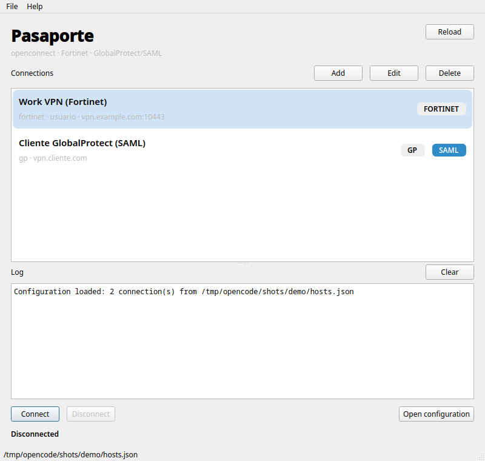
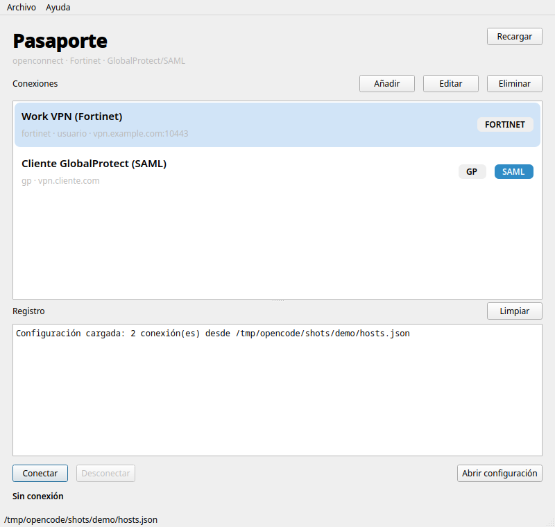

# Pasaporte

**English** · [Español](./README.es.md)

[](https://github.com/jsnoriegam/Pasaporte/actions/workflows/appimage.yml)
[](https://github.com/jsnoriegam/Pasaporte/releases)
[](./LICENSE)

[](https://buymeacoffee.com/jsnoriegam)

A **Python + PySide6/Qt** graphical interface for `openconnect`, with
integrated **GlobalProtect with SAML** support inside the application itself
(embedded WebView).

The same JSON connection list works for Fortinet, GlobalProtect and the rest
of the openconnect protocols.



## Requirements

- Linux with a desktop environment (X11 or Wayland).
- Python 3.10 or newer.
- `openconnect` installed and on `PATH` (or set `OPENCONNECT_BIN` to its path).
- `pkexec` (recommended) or `sudo`.
- PySide6 with the `QtWebEngineWidgets` and `QtWebSockets` modules.
  The `PySide6` package from PyPI includes them.

Quick checks:

```bash
openconnect --version
which pkexec
.venv/bin/python -c "import PySide6; from PySide6 import QtWebEngineWidgets, QtWebSockets; print(PySide6.__version__)"
```

## Installation

Everything is installed inside the project, in `.venv/`; there is no need to
touch the system-wide packages:

```bash
cd /path/to/pasaporte

python3 -m venv .venv
.venv/bin/pip install -r requirements.txt
```

If `.venv` already exists, just install/update the dependencies:

```bash
.venv/bin/pip install -r requirements.txt
```

## Running

```bash
# default configuration: ~/.config/pasaporte/hosts.json
./pasaporte

# or point to another file
./pasaporte --config ~/.config/vpn/hosts.json

# with the venv activated
PYTHONPATH=src python3 -m pasaporte --config ./vpn.json

# connect automatically on startup (by connection name)
./pasaporte --config vpn.json --connect UTB

# print the version
./pasaporte --version
```

`./pasaporte` automatically detects and uses the project `.venv` if it exists,
even when it is not activated. That way it does not depend on the system-wide
packages.

On first launch, if `~/.config/pasaporte/hosts.json` does not exist and there
is a configuration in `~/.config/vpn/hosts.json` or in `vpn.json`, Pasaporte
will offer **Import** or **Use this session only**. In read-only mode you can
migrate later with the **Migrate configuration** button.

The `VPN_CONFIG` variable can also be used:

```bash
VPN_CONFIG=./vpn.json ./pasaporte
```

> Important: use `./pasaporte` or `PYTHONPATH=src python3 -m pasaporte`. If you
> import the package and create the `QApplication` yourself, you must configure
> the DevTools port before initializing QtWebEngine. The launcher already does
> this.

### System tray

With a system tray, closing or minimizing the window keeps Pasaporte running
in the tray, so the VPN stays connected. Turn this off with
**File → Minimize to tray**. Quit with **File → Quit** (`Ctrl+Q`) or from the
tray menu.

GNOME does not show tray icons by default. Install the *AppIndicator and
KStatusNotifierItem Support* extension to get one; without a tray the option
is disabled and closing the window quits the app.

The tray icon shows the connection state, and its tooltip shows the status
text. Notifications appear when a connection is established while the window
is hidden, when a connection drops, and when an error occurs.

### Reconnection and start at login

- **File → Reconnect automatically** (off by default). If the tunnel drops
  without you disconnecting, Pasaporte retries after 5, 15 and 30 seconds.
  While this is on, the password you typed is kept **in memory only** until
  you disconnect or the retries run out; it is never written to disk. SAML
  sessions cannot be renewed in the background, so after a drop you must
  connect again and sign in.
- **File → Start at login** creates
  `~/.config/autostart/io.github.jsnoriegam.pasaporte.desktop`. Pasaporte then
  starts hidden in the tray (`--start-hidden`). With the AppImage, the entry
  points to the AppImage's current path: turn the option off and on again if
  you move the file.

### Launching from the application menu

The project includes `pasaporte.desktop`. To install it:

```bash
mkdir -p ~/.local/share/applications
cp pasaporte.desktop ~/.local/share/applications/
update-desktop-database ~/.local/share/applications 2>/dev/null || true
```

Adjust the `Exec=` line if you move the project elsewhere.

## AppImage

The AppImage bundles Python, PySide6 and QtWebEngine. It **does not include
openconnect**: it uses the system one or the one you point to with
`OPENCONNECT_BIN`.

### Building

With Podman (recommended):

```bash
./packaging/build-in-podman.sh
```

With Docker:

```bash
CONTAINER_ENGINE=docker ./packaging/build-in-podman.sh
```

The result is written to:

```
dist/Pasaporte-0.1.0-beta.2-x86_64.AppImage
```

The build uses Ubuntu 22.04 inside the container to keep glibc compatibility.
The first run downloads PySide6 inside the container.

### Running

```bash
chmod +x dist/Pasaporte-*.AppImage
./dist/Pasaporte-*.AppImage
```

It requires the following on the host:

- `openconnect` (or `OPENCONNECT_BIN=/path/to/openconnect`)
- `pkexec` (or passwordless `sudo` with `VPN_GUI_PRIVILEGE=sudo`)
- `vpnc-script` (used by openconnect)

Example with an explicit path:

```bash
OPENCONNECT_BIN=/opt/openconnect/bin/openconnect ./Pasaporte-*.AppImage
```

### AppImage notes

- **QtWebEngine sandbox:** `AppRun` sets `QTWEBENGINE_DISABLE_SANDBOX=1`
  because an AppImage cannot ship Chromium's setuid helper. This is a security
  trade-off; the WebView is only used for the SAML login.
- **SAML verified:** the AppImage was tested against UTB and the WebView loaded
  the Microsoft login inside the bundle.
- **Size:** ~195 MB (QtWebEngine accounts for most of it).
- **i18n:** includes the Pasaporte translations and `qtbase_es.qm`.
- **Openconnect is not bundled:** it is looked up on `PATH` and, if missing,
  the app suggests `OPENCONNECT_BIN`.
- **Host dependencies:** besides `openconnect`, `pkexec` and `vpnc-script`,
  QtWebEngine uses system libraries such as `libnss3`, `libnspr4` and
  `libgbm1`, which are present on any modern desktop.
- **Compatibility:** built on Ubuntu 22.04, so it requires glibc >= 2.35
  (Ubuntu 22.04+, Fedora 35+, Debian 12+).
- **Wayland/X11:** both Qt plugins are included; testing both is recommended.
- **CI:** `.github/workflows/appimage.yml` runs the tests, builds the AppImage
  with Docker on every push to `main` (downloadable as an artifact) and
  publishes it in a release when a `v*` tag is pushed.


## Connection management

From the main window you can:

- **Add** a connection with the `Add` button or `Ctrl+N`.
- **Edit** the selected one with `Edit`, `Ctrl+E` or the context menu.
- **Delete** the selected one with `Delete`, `Del` or the context menu.
- **Reload** the JSON with `F5`.

The edit dialog has three tabs:

- **General**: name, host, username, protocol, `servercert` and description.
- **GlobalProtect / SAML**: `saml`, `gateway`, `--os`, `clientos`,
  `usergroup`, User-Agent and `ignore_redirects`.
- **Advanced**: elevation (`pkexec`/`sudo`), `no_verify`,
  `allow_insecure_crypto` and extra arguments (one per line).

Writes are atomic, with `0600` permissions and a `hosts.json.bak` backup before
every change. If the JSON is modified outside the app, you will be asked for
confirmation before overwriting it. Unknown fields you add by hand are
preserved.

> Passwords and cookies are **not** stored in the JSON.

### `username` with SAML

With GlobalProtect and SAML, `username` is **optional**. The real user comes
from the `saml-username` header returned by the ACS. The username field is only
used as a fallback when the ACS does not return it; in that case the app warns
you and lets you add it in the configuration.

## Configuration

The file is a JSON array of connections with optional fields. You can start
from [`vpn.example.json`](./vpn.example.json).

### Path and migration

The canonical path is:

```
${XDG_CONFIG_HOME:-~/.config}/pasaporte/hosts.json
```

Precedence:

1. `--config`
2. `$VPN_CONFIG`
3. `~/.config/pasaporte/hosts.json`
4. Read-only fallback to `~/.config/vpn/hosts.json` or the project `vpn.json`

On first launch, if the canonical path does not exist and a legacy one does,
the app asks whether to import it. If you choose **Continue without migrating**,
it is loaded in read-only mode: you will see a banner at the top and the
**Migrate now** button to copy it whenever you want.

You can also **Import** or **Export** from the `File` menu. Importing allows
replacing everything or merging by name. All writes are atomic, with backup and
`0600` permissions.

### Fields

| Field | Required | Description |
|---|---|---|
| `name` | no | Display name. If missing, `host` is used. |
| `host` | yes | Server, with optional port (`vpn.client.com:443`). No `https://` and no path. |
| `username` | yes / no | Required except for `gp` with `saml: true`. |
| `protocol` | no | `fortinet` (default), `gp`, `anyconnect`, `pulse`, `nc`, `f5`, `array`. |
| `servercert` | no | Certificate pin (`pin-sha256:...`, `sha256:...`, `sha1:...`). Strongly recommended. |
| `saml` | no | `true` for GlobalProtect with SAML. Only valid with `protocol: "gp"`. |
| `gateway` | no | `true` to authenticate against the *gateway* interface instead of the *portal*. |
| `usergroup` | no | Forces openconnect's `--usergroup` (e.g. `gateway:prelogin-cookie`). |
| `os` | no | `--os` value for GlobalProtect: `win`, `linux-64`, `mac-intel`, etc. Defaults to `win` with SAML. |
| `clientos` | no | `clientos` sent to `prelogin.esp`: `Windows`, `Linux`, `Mac`. Defaults to `Windows`. |
| `useragent` | no | User-Agent for `prelogin.esp` and openconnect's `--useragent`. Defaults to `PAN GlobalProtect`. |
| `browser_useragent` | no | User-Agent for the SAML WebView. Usually not needed. |
| `ignore_redirects` | no | If `true`, connects to the original `host` even when the ACS is on another host. |
| `no_verify` | no | **Insecure.** Ignores TLS errors in `prelogin.esp` and in the WebView. |
| `allow_insecure_crypto` | no | Adds `--allow-insecure-crypto` to openconnect. |
| `privilege` | no | `pkexec` or `sudo` for this connection. |
| `extra_args` | no | List of extra arguments for openconnect. |
| `description` | no | Free text shown below the name. |

> `--os` and `clientos` are not the same thing: `clientos` is sent to the
> portal in the SAML prelogin; `--os` is passed to openconnect for the tunnel.
> In the editor you can enable **"Sync --os with clientos"** to map
> Windows→win, Linux→linux-64 and Mac→mac-intel. If a portal only offers SAML
> with `clientos=Windows`, you can keep `clientos=Windows` and use
> `--os=linux-64` by disabling the sync.

### Fortinet example

```json
{
  "name": "Work VPN",
  "host": "vpn.example.com:10443",
  "username": "usuario",
  "protocol": "fortinet",
  "servercert": "pin-sha256:REEMPLAZAR_CON_TU_PIN=="
}
```

### GlobalProtect with SAML example

```json
{
  "name": "UTB",
  "host": "vpn3.utb.edu.co",
  "protocol": "gp",
  "saml": true,
  "gateway": false,
  "os": "win",
  "clientos": "Windows"
}
```

`username` can be omitted: the one returned by the ACS will be used.

If the portal redirects to the gateway and the connection fails, try
`"gateway": true`. You can also force the exact value with:

```json
"usergroup": "gateway:prelogin-cookie"
```

## How SAML works

1. The app sends a `POST` to `global-protect/prelogin.esp` (portal) or
   `ssl-vpn/prelogin.esp` (gateway) and obtains the SAML request.
2. That request is loaded in an embedded `QWebEngineView`.
3. The user completes SSO (Okta, Azure AD, etc.).
4. The GlobalProtect ACS responds with the
   `saml-username`, `saml-auth-status` and `prelogin-cookie` /
   `portal-userauthcookie` headers.
5. QtWebEngine does not expose response headers, so the app uses the
   **DevTools (CDP)** protocol on a random local port to read them.
6. The cookie is passed to `openconnect` over **stdin**, never through `argv`:

```bash
echo "$COOKIE" | openconnect --protocol=gp \
  --user=... --os=win \
  --usergroup=gateway:prelogin-cookie \
  --passwd-on-stdin vpn.client.com
```

## Privileges

`openconnect` needs root to create the `tun` interface, but the GUI does not run
as root.

- By default `pkexec` is used: the desktop Polkit dialog appears. `pkexec`
  preserves stdin, which is what we need for the password/cookie.
- If you prefer `sudo`, the app runs `sudo -n openconnect ...` and needs
  passwordless sudoers. Example (adjust the user/group and path):

```sudoers
%wheel ALL=(root) NOPASSWD: /usr/bin/openconnect
```

> That rule allows running openconnect with arbitrary arguments. If that worries
> you, create a wrapper with fixed arguments and authorize only that wrapper.

To force the mode:

```bash
VPN_GUI_PRIVILEGE=pkexec ./pasaporte
VPN_GUI_PRIVILEGE=sudo   ./pasaporte
```

## Security

- The password and the SAML cookie are written to the process stdin; they are
  not stored on disk and do not appear in `ps`.
- With *Reconnect automatically* on, the password is kept in memory until you
  disconnect or the retries run out. It is never written to disk.
- The JSON is written with `0600` permissions and a `hosts.json.bak` backup.
- The WebView profile is ephemeral: it does not persist IdP cookies.
- The DevTools port is random and listens only on `127.0.0.1`.
- `no_verify` disables TLS validation during login. Use it only temporarily.
- Configure `servercert` whenever possible.

## Troubleshooting

**`CERTIFICATE_VERIFY_FAILED` in `prelogin.esp`**
The app uses the system CA store. If the server uses a corporate CA that is not
installed, add it to the system store or use `"no_verify": true` temporarily for
the login. For the final connection, openconnect will still validate the
certificate: configure `servercert` or `--cafile` in `extra_args`.

**`DevTools not available` / headers are not captured**
Start with `./pasaporte` or `PYTHONPATH=src python3 -m pasaporte`. Do not set
`QTWEBENGINE_REMOTE_DEBUGGING` manually unless you know what you are doing.

**`openconnect could not be executed` (code 126/127)**
The Polkit dialog was canceled or `sudo` asked for a password. Check
`VPN_GUI_PRIVILEGE` and the sudoers rule.

**The WebView stays blank or QtWebEngine does not start**
In containers or environments without a sandbox:

```bash
QTWEBENGINE_DISABLE_SANDBOX=1 ./pasaporte
```

**The portal does not advertise SAML**
Try the other interface (`gateway: true/false`) and a different `clientos`
(`Windows`, `Mac`, `Linux`). The error includes the URL that was queried.

**The IdP does not complete the login or stays blank**
Some providers block embedded browsers or depend on pop-up windows. Try
`browser_useragent` (a standard Chrome User-Agent) and check the log. The
current WebView does not handle SSO popups.

**The server certificate is not valid**
Add `servercert` with the correct pin. If the portal redirects to a gateway on
another host, the pin must be the one of the **gateway** shown in the log (or
use `ignore_redirects` if you want to force the configured host).

**`Result 512` / "Invalid authentication cookie" after SAML**
The portal rejected the cookie. The usual causes, in order:

1. **Wrong interface.** `gateway` must match where you started the SAML. If
   `gateway: false`, the `usergroup` will be `portal:prelogin-cookie`. If the
   connection fails, try changing `gateway` in the editor.
2. **Expired cookie.** SAML cookies are short-lived. If you took too long to
   complete the login or to accept the pkexec dialog, connect again.
3. **Forced `usergroup`.** If you set a `usergroup` by hand on the connection,
   remove it so it is generated automatically.

**The connection stays on "Connecting…"**
Look at the log: openconnect writes the real error there (credentials,
certificate, HIP, etc.). The app uses `--non-inter`; if the server requires an
additional interactive prompt, the value will have to be added through the
configuration.

**Disconnecting does not close the VPN**
Pasaporte closes openconnect with `pkexec kill` (or `sudo -n kill`) on the same
PID. If you cancel the authorization, the VPN stays up and the log says so. To
close a session the app no longer controls:

```bash
pkexec pkill -x openconnect
```

## Languages

Pasaporte uses **English** as the source language and **Spanish** as a
translation. The language is chosen in `File → Language`:

- **Automatic (system):** uses the desktop language; if there is no
  translation, English.
- **English**
- **Spanish**

The change is applied live, without restarting. New dialogs appear in the
active language.



### Adding a language

1. Copy `src/pasaporte/translations/pasaporte_es.ts` to
   `pasaporte_<code>.ts`.
2. Translate with `pyside6-linguist`.
3. Compile with `pyside6-lrelease`.
4. Add it to `LANGUAGES` in `src/pasaporte/i18n.py`.

To regenerate the strings:

```bash
pyside6-lupdate -extensions py -recursive src/pasaporte \
  -ts src/pasaporte/translations/pasaporte_es.ts
pyside6-lrelease src/pasaporte/translations/pasaporte_es.ts \
  -qm src/pasaporte/translations/pasaporte_es.qm
```

## Versioning

Pasaporte uses [SemVer](https://semver.org/). The version lives in
`src/pasaporte/constants.py` (`APP_VERSION`) and is mirrored in the AppStream
metadata.

- Releases are tagged `v<APP_VERSION>`, e.g. `v0.1.0-beta.1`.
- A tag containing `-` is published as a GitHub pre-release.
- The CI workflow fails if the tag does not match `APP_VERSION`.

```bash
./pasaporte --version
```

## Development

The code is in `src/pasaporte/`. To run the tests:

```bash
QT_QPA_PLATFORM=offscreen .venv/bin/python -m unittest discover -s tests -v
```

They cover atomic persistence, backups, permissions, validation, editing,
main-window CRUD, migration to `~/.config/pasaporte`, merge import,
connect/disconnect cycle, SAML, `usergroup`, i18n and openconnect detection
(`OPENCONNECT_BIN`).

## Status

Tested with:

- PySide6 6.11.2 (Qt 6.11) and PySide6 6.12.0 (Qt 6.12)
- openconnect 9.21
- Linux (Wayland/X11)
- 91 automated tests (configuration, CRUD, cancellations, migration, SAML,
  connect/disconnect cycle, window close, i18n and `OPENCONNECT_BIN`)
- AppImage packaging with Podman/Docker (PyInstaller + appimagetool)

The SAML flow was validated with a simulated ACS that returns the
`prelogin-cookie` and `saml-username` headers, and against the real prelogin of
`vpn3.utb.edu.co` (redirect to Microsoft Entra ID). Against a real GlobalProtect
server it may require adjusting `gateway`, `clientos`, `os` or `usergroup`.

## License

Pasaporte is free software licensed under the
[GNU General Public License v3.0 or later](./LICENSE).

## Changelog

Release history is in [CHANGELOG.md](./CHANGELOG.md).

## Contributing

Bugs and feature requests go through the
[issue templates](https://github.com/jsnoriegam/Pasaporte/issues/new/choose).

## Support

If Pasaporte is useful to you, you can buy me a coffee:

[](https://buymeacoffee.com/jsnoriegam)
